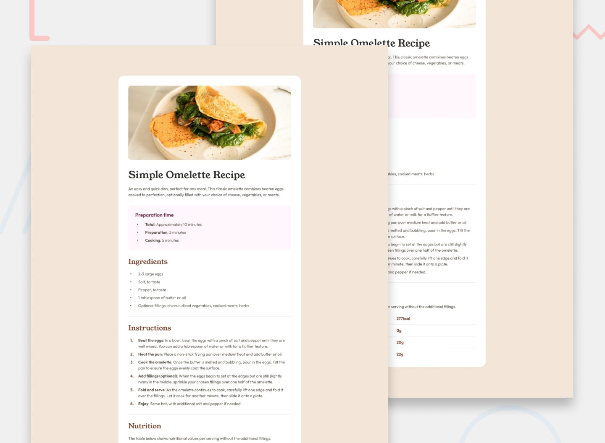

# Frontend Mentor - Recipe page



## Table of contents

- [Overview](#overview)
  - [The challenge](#the-challenge)
  - [Links](#links)
- [My process](#my-process)
  - [Built with](#built-with)
  - [What I learned](#what-i-learned)
- [Author](#author)

## Overview

### The challenge

Your challenge is to build out this recipe page and get it looking as close to the design as possible.

You can use any tools you like to help you complete the challenge. So if you've got something you'd like to practice, feel free to give it a go.

Your users should be able to:

- View the optimal layout depending on their device's screen size
- Read the recipe's preparation time, ingredients, step-by-step instructions and nutrition facts in a clear, accessible structure

### Links

- Live Site URL: [github pages](https://GerardoCianciulli.github.io/Recipe-page/)

## My process

### Built with

- Semantic HTML5 markup
- CSS custom properties
- Flexbox
- CSS counters
- Desktop-first workflow
- Media Queries
- [React](https://react.dev/) - JS library
- [Typescript](https://www.typescriptlang.org/)
- [Vite](https://vite.dev/) - Build tool
- [gh-pages](https://www.npmjs.com/package/gh-pages) - Deployment to GitHub Pages

### What I learned

The design uses small round bullets and brown numbers that the default `::marker` can't match, so I drew them with `::before` and drove the colour from one custom property. The "Preparation time" box only needs to override `--marker-color` to switch its bullets to rose, and CSS counters handle the numbering for the instructions.

```css
.section {
  --marker-color: var(--color-brown-800);
}

.section--highlight {
  --marker-color: var(--color-rose-800);
}

.list--bullet li::before {
  content: '';
  position: absolute;
  top: 50%;
  left: var(--spacing-100);
  width: 4px;
  height: 4px;
  border-radius: 50%;
  background-color: var(--marker-color);
  transform: translateY(-50%);
}

.list--numbered {
  counter-reset: step;
}

.list--numbered li::before {
  content: counter(step) '.';
  color: var(--marker-color);
}
```

I kept every section's markup consistent by building one reusable `Section` component in Typescript. It accepts its content as `children` and an optional `variant` prop, and wires up `aria-labelledby` so each section is announced by its heading.

```tsx
type SectionProps = {
  id: string
  title: string
  variant?: 'default' | 'highlight'
  children: ReactNode
}

const Section = ({ id, title, variant = 'default', children }: SectionProps) => {
  const headingId = `${id}-heading`

  return (
    <section className={`section section--${variant}`} aria-labelledby={headingId}>
      <h2 id={headingId} className="section__title">{title}</h2>
      {children}
    </section>
  )
}
```

The nutrition facts are tabular data, so I used a real `<table>` with `<th scope="row">` for each nutrient instead of styled `div`s. Screen readers can then read each value together with its label.

```tsx
<table className="nutrition-table" aria-describedby={descriptionId}>
  <tbody>
    {nutrients.map(({ name, value }) => (
      <tr key={name}>
        <th scope="row">{name}</th>
        <td>{value}</td>
      </tr>
    ))}
  </tbody>
</table>
```

Finally, I learned that GitHub Pages serves a project from a sub-folder, so Vite needs a `base` path. Without it the built CSS, JS, fonts and images all 404.

```ts
export default defineConfig({
  base: '/Recipe-page/',
  plugins: [react()],
})
```

## Author

- Portfolio - [Gerardo Cianciulli](https://www.behance.net/gerardo-cianciulli)
- Frontend Mentor - [Gerardo Cianciulli](https://www.frontendmentor.io/profile/GerardoCianciulli)
- Linkedin - [Gerardo Cianciulli](https://www.linkedin.com/in/gerardo-cianciulli/)
